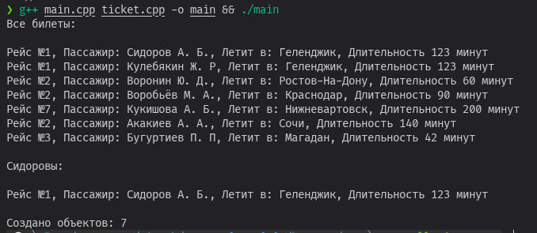

# Лабораторная работа 1 (Вариант 2)

## Постановка задачи

В текстовом файле хранится информация о проданных авиабилетах
Для каждого билета известны:
- номер рейса;
- фамилия и инициалы пассажира;
- пункт назначения;
- продолжительность рейса в минутах.
Количество проданных билетов неизвестно.

Необходимо:
1.	Выгрузить информацию о всех проданных билетах и вывести на экран.
2.	Выяснить на какие рейсы купили билеты пассажиры по фамилии Сидоров.
Требования для реализации:
1.	Для работы со своими объектами опишите класс «Авиабилет».
2.	Все поля должны быть приватными и динамическими.
3.	Реализуйте хотя бы один конструктор и деструктор.

Дополнительное задание к приведенному в файле: при помощи статического поля класса, добавив в конструктор-деструктор соответствующий код, определите количество созданных объектов!

## Реализация

