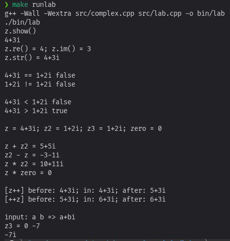

# Лабораторная работа 12

## Постановка задачи

Описать класс «Комплексное число».
Определить методы: конструктор (Complex), деструктор (~Complex), метод вывода информации  (Show).
Переопределить операции: +,  =,  *,  >>,  <<.

Для класса «Комплексное число» добавить методы: копирующий конструктор.
Для класса «Комплексное число» переопределить операции: префиксный и постфиксный инкремент ++, +=,  >,  -.

## Компиляция и запуск

```bash
make runlab
```

## Вывод

