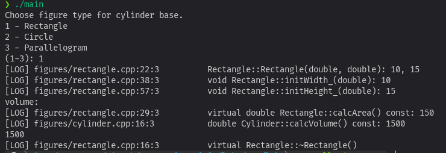
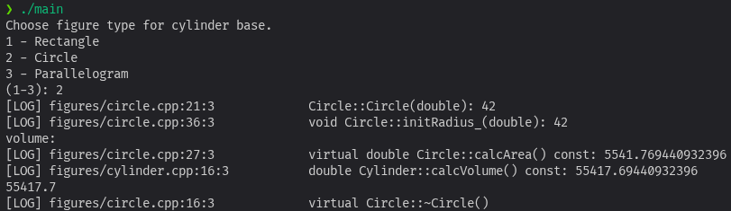
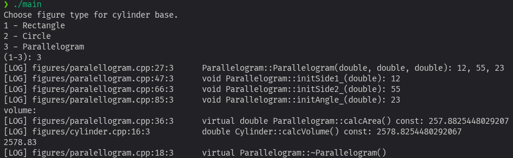
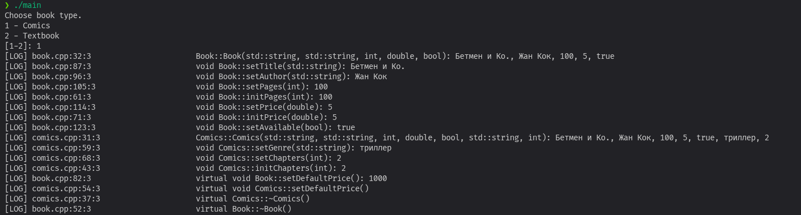
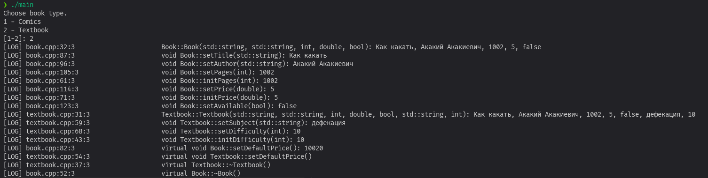

# Лабораторная работа 8

## **Лабораторное задание**

## Постановка задачи

Внести изменения в Лабораторную работу № 7.
1.	Реализовать еще один класс: Cylinder.
Набор полей: основание `Figure* F` и высота `double H`.
Определить метод вычисления объема.
2.	В главной программе спрашивать у пользователя какое основание цилиндра
он хочет выбрать и создавать для выбранного основания цилиндр. Вычислять объем созданного цилиндра.

## Описание программы

Базовый класс фигуры был сделан абстрактным. Добавлен метод `copy`
для копирования класса внутрь экземпляра цилиндра.

## Компиляция

```bash
g++ main.cpp log.cpp figures/rectangle.cpp figures/circle.cpp figures/paralellogram.cpp figures/cylinder.cpp -o main
```

## Выполнение

### Прямоугольный цилиндр

### Круглый цилиндр

### Паралеллограмный цилиндр


## **Домашнее задание**

## Постановка задачи

Внести изменения в Домашнее задание 6: Сделать родительский класс абстрактным.

## Описание программы

Метод `setDefaultPrice` был сделан виртуальным. Его вызов в
конструкторе был заменён на `Book::setDefaultPrice` для
устранения неопределённости. В демонстрации убрана обычная книга,
т.к. нельзя создать экземпляр абстрактного класса.

Помимо этого я заменил весь старый отладочный вывод на свой `LOG()`, код стал намного чище

## Компиляция

```bash
g++ main.cpp log.cpp book.cpp textbook.cpp comics.cpp -o main
```

## Выполнение

### Комикс

### Учебник
