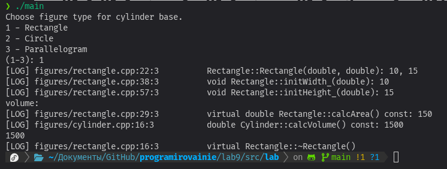
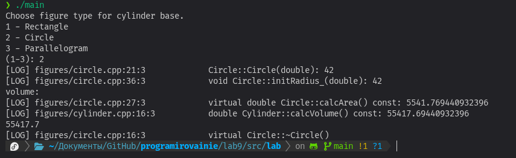
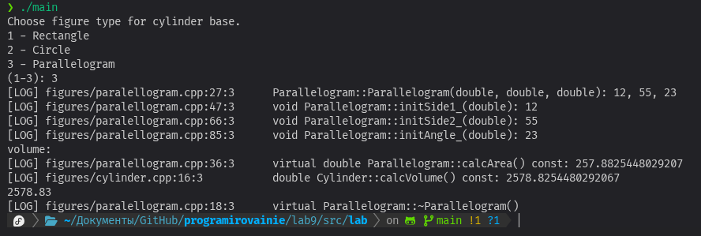
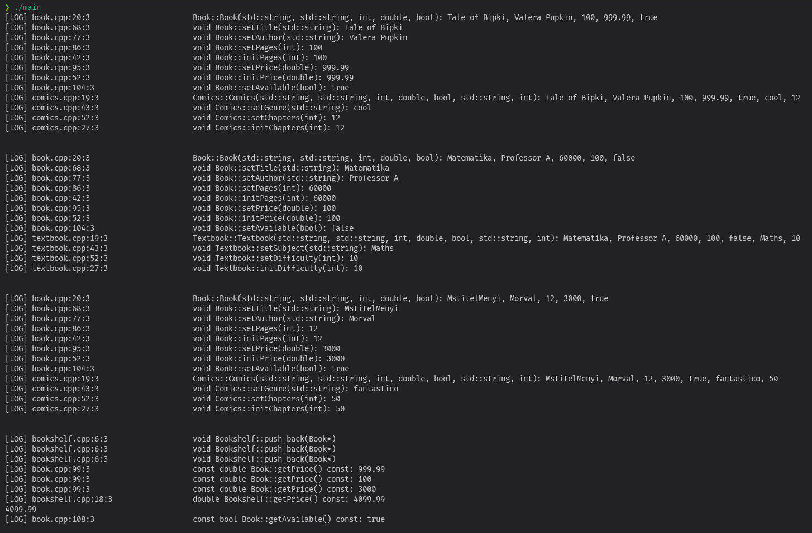
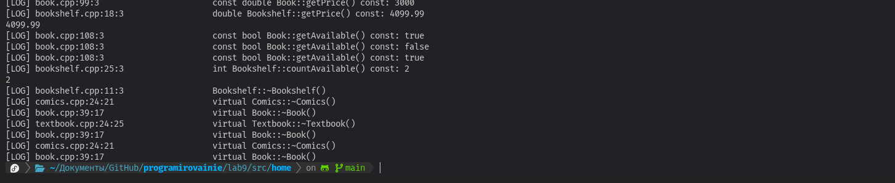

# Лабораторная работа 9

## **Лабораторное задание**

## Постановка задачи

Внести изменения в лабораторную работу №8:

1.	Реализовать иерархию классов-цилиндров. Цилиндр с произвольным основанием, цилиндр с круглым основанием и т.д.
2.	Родительский класс: Cylinder. Потомки – CirCylinder, RectCylinder и MyCylinder.
3.	Создавать в главной программе разные цилиндры, выводить информацию о них и вычислять объемы.

## Компиляция

```bash
 g++ main.cpp log.cpp figures/rectangle.cpp figures/circle.cpp figures/paralellogram.cpp cylinders/cylinder.cpp cylinders/cirCylinder.cpp cylinders/rectCylinder.cpp cylinders/parCylinder.cpp
```

## Выполнение






## **Домашнее задание**

## Постановка задачи

Внести изменения в Домашнюю работу 8:

1.	Описать еще один класс, одним из полей которого является поле типа родительского класса определенной ранее иерархии.
2.	Создавать объекты нового класса и демонстрировать работу всех его методов.

## Описание программы

Реализован класс "Книжная полка". На полку можно класть книги, и после этого рассчитывать их суммарную стоимость, а также считать сколько из них сейчас в наличии.

## Компиляция

```bash
g++ main.cpp log.cpp book.cpp textbook.cpp comics.cpp bookshelf.cpp -o main
```

## Выполнение


